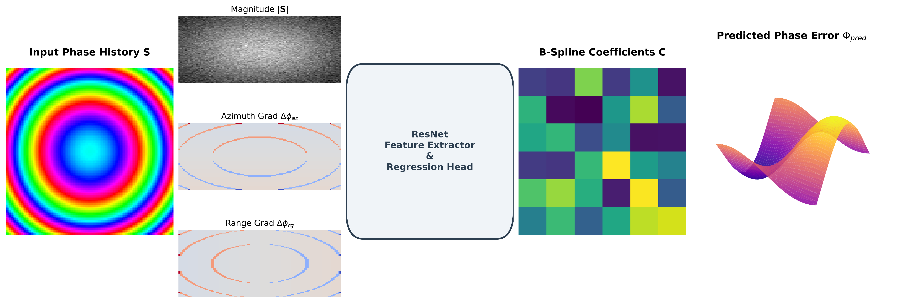

# PolyPhaseNet: Phase Gradient-Based Deep Learning for 2D Non-Separable SAR Autofocus

[](https://www.python.org/downloads/)
[](https://pytorch.org/)
[](https://opensource.org/licenses/MIT)
[](https://ieee-aess.org/publication/transactions-aerospace-and-electronic-systems)

Official PyTorch implementation of **PolyPhaseNet** from the paper:  
**"Phase Gradient-Based Deep Learning for 2D Non-Separable SAR Autofocus"**  
*Muhammed Burak Alver*  
*IEEE Transactions on Aerospace and Electronic Systems (TAES), Manuscript ID: TAES-2026-3321.*

---

## 📌 Overview

Synthetic Aperture Radar (SAR) imagery in wide-angle, high-resolution spotlight modes is subject to **two-dimensional non-separable phase errors** $\Phi(\eta, r)$ caused by uncompensated platform trajectory drift, atmospheric turbulence, and cross-range acceleration. Existing learning-based autofocus algorithms ingest raw complex phase history or wrapped phase angles $\mathcal{W}(\phi) = \phi \bmod 2\pi$, which degrades when phase deviations exceed $2\pi$ radians.

**PolyPhaseNet** resolves this through three core contributions:
1. **Physics-Informed 2D Phase-Gradient Extraction:** Computes adjacent-sample complex conjugate products in the range-compressed slow-time domain $\mathbf{S}_{\text{err}}(\eta, r) = \mathcal{F}_{az}^{-1}\{\mathbf{Y}(x, r)\}$, mitigating global $2\pi$ phase-wrapping jump discontinuities whenever local phase gradients satisfy the Nyquist condition $|\Delta\phi| \le \pi$.
2. **2D Tensor-Product Cubic B-Spline Prior ($K \times L = 64 \times 16 = 1,024$ coefficients):** Regresses the full 2D non-separable control matrix $\mathbf{C} \in \mathbb{R}^{64 \times 16}$ over exact clamped uniform Cox--de Boor cubic B-Spline bases $\mathbf{\Phi} = \mathbf{B}_{az}\mathbf{C}\mathbf{B}_{rg}^T$, achieving $-18.1$ dB clutter speckle variance reduction.
3. **Episodic Safeguarded Test-Time Adaptation (TTA):** Employs an episodic per-patch adaptation protocol that freezes the CNN backbone, optimizes only $\mathbf{C}$ with an $\ell_2$ trust-region penalty, and evaluates candidate iterates via an unsupervised Entropy Verification Gate to eliminate cross-sample parameter drift.



---

## 🚀 Key Highlights & Benchmarks

* **Sub-Millisecond Speed:** Pure network forward pass in **0.54 ms**; complete end-to-end reconstruction (including 2D conjugate gradient extraction, CNN+MLP inference, B-Spline synthesis, phase compensation, and 1D azimuth FFT) in **0.92 ms** on a single NVIDIA RTX 5060 Ti GPU.
* **Large-Scale Real SAR Evaluation:** Trained and benchmarked on **5,741 complex patches** from **133 Umbra X-band SICD spotlight scenes** across 40 geographic locations with strict parent-scene holdout (including 9 completely held-out geographic cities).
* **Comprehensive Baselines:** Outperforms classical 1D PGA, 2D PGA, and Minimum Entropy Autofocus (MEA), as well as PAFnet, LEAP-Net, and Deep Unfolding (AF-DCDU-Net).

| Method | Paradigm | Latency (ms) | Mild SSIM | Moderate SSIM | Severe SSIM |
| :--- | :--- | :---: | :---: | :---: | :---: |
| Defocused (Input) | -- | -- | 0.6974 | 0.6030 | 0.4907 |
| 1D PGA (8 iters) | Classical Iterative | 5.09 | 0.5284 | 0.4533 | 0.4090 |
| 2D PGA (8 iters) | Classical Iterative | 20.14 | 0.4632 | 0.4180 | 0.3910 |
| MEA (25 iters) | Metric Optimization | 29.66 | 0.6596 | 0.6061 | 0.5567 |
| PAFnet (w/o B-Spline) | CNN (Direct) | 0.89 | 0.7012 | 0.6163 | 0.5049 |
| LEAP-Net (w/o B-Spline) | CNN + Attention | 1.19 | 0.6989 | 0.6181 | 0.5002 |
| AF-DCDU-Net (3-stage) | Deep Unfolding | 1.84 | 0.7105 | 0.6240 | 0.5112 |
| **PolyPhaseNet (Zero-Shot)** | **Feed-Forward** | **0.92** | **0.8444** | **0.7278** | **0.5582** |
| **PolyPhaseNet + Episodic TTA** | **Hybrid Adaptive** | **8.70** | **0.8592** | **0.7410** | **0.5744** |

---

## 📂 Repository Structure

```
PolyPhaseNet/
├── README.md               # Documentation and benchmark overview
├── LICENSE                 # MIT License
├── requirements.txt        # Python package dependencies
├── .gitignore              # Ignored files
├── demo.py                 # Self-contained CLI demonstration
├── polyphasenet/
│   ├── __init__.py         # Package exports
│   ├── model.py            # PolyPhaseNet, PAFNet, LEAP-Net, AF-DCDU-Net models
│   ├── bspline.py          # Clamped uniform Cox-de Boor B-Spline basis generator
│   ├── classical.py        # 1D PGA, 2D PGA, and MEA implementations
│   └── tta.py              # Episodic Safeguarded Test-Time Adaptation
├── data/
│   ├── __init__.py
│   ├── dataset.py          # SICD SLC patch loader & synthetic error generator
│   └── splits/             # Train (106 scenes), Val (13 scenes), Test (14 scenes) lists
├── checkpoints/            # Pre-trained PyTorch model weights (.pth)
│   ├── best_polyphasenet_2d_full.pth
│   ├── best_model_ft_mild.pth
│   ├── best_model_ft_moderate.pth
│   └── best_model_ft_severe.pth
└── assets/                 # Diagrams, comparison figures, and demo outputs
```

---

## 🛠️ Installation

```bash
# 1. Clone repository
git clone https://github.com/mburakalver/PolyPhaseNet.git
cd PolyPhaseNet

# 2. Create and activate a virtual environment
python -m venv venv
# On Windows:
venv\Scripts\activate
# On Linux/macOS:
source venv/bin/activate

# 3. Install dependencies and local package
pip install -r requirements.txt
pip install -e .
```

---

## ⚡ Quickstart Demo

Run the interactive demonstration script to simulate 2D non-separable coupled phase errors, execute PolyPhaseNet feed-forward inference, apply Episodic Safeguarded TTA, and visualize the focused reconstruction:

```bash
python demo.py
```

The script will output metrics and save a visual comparison to `assets/demo_result.png`:
```
[+] Running PolyPhaseNet Demo on device: cuda
[+] Loading pre-trained weights from checkpoints/best_polyphasenet_2d_full.pth...
[+] Executing Episodic Safeguarded TTA (6 iterations)...

=======================================================
DEMO PERFORMANCE SUMMARY:
=======================================================
  Defocused (Input)    : SSIM = 0.8946 | PSNR = 36.86 dB
  PolyPhaseNet (0-shot): SSIM = 0.8913 | PSNR = 36.54 dB | Phase MSE = 7.0884 rad^2
  PolyPhaseNet + TTA   : SSIM = 0.9011 | PSNR = 37.62 dB | Phase MSE = 6.8097 rad^2
=======================================================
[+] Visual result saved to assets/demo_result.png
```

---

## 💻 Programmatic Python Usage

You can directly import and integrate PolyPhaseNet into your own SAR processing pipeline:

```python
import torch
from polyphasenet.model import PolyPhaseNet
from polyphasenet.tta import episodic_safeguarded_tta

device = torch.device('cuda' if torch.cuda.is_available() else 'cpu')

# 1. Initialize model with pre-computed B-Spline basis matrices
model = PolyPhaseNet(
    az_dim=256, rg_dim=256,
    az_points=64, rg_points=16,
    degree=3, mode='tensor_grid'
).to(device)

# 2. Load pre-trained checkpoint weights
checkpoint = torch.load('checkpoints/best_polyphasenet_2d_full.pth', map_location=device)
model.load_state_dict(checkpoint['model_state_dict'])
model.eval()

# 3. Feed-forward zero-shot autofocus
# S_in: range-compressed slow-time signal, shape (1, 1, Azimuth, Range), complex64
with torch.no_grad():
    X_focused, phi_est, C_grid = model(S_in)

# 4. Optional: Run Episodic Safeguarded TTA for out-of-distribution phase errors
X_tta, phi_tta = episodic_safeguarded_tta(model, S_in, steps=6, lr=1.5e-2)
```

---

## 🔬 Reproducing Paper Experiments

### Data Preparation
The experimental evaluation utilizes open-access X-band spotlight SICD SLC data from the [Umbra Open Data Program](https://registry.opendata.aws/umbra-open-data/). The exact parent-scene splits are documented in `data/splits/`:
- `data/splits/train_split.txt`: 106 parent scenes (4,469 patches)
- `data/splits/val_split.txt`: 13 parent scenes (612 patches)
- `data/splits/test_split.txt`: 14 parent scenes (660 patches, with 9 held-out geographic locations)

### Evaluation Metrics
All metrics in the manuscript are calculated using:
1. **2D Sub-pixel Registration:** Aligns magnitude predictions with ground truth via cross-correlation to eliminate bulk cyclic phase translation ambiguities.
2. **Piston-Aligned Phase MSE:** Removes the unobservable global phase offset $\mu_\Delta = \frac{1}{AR}\sum(\hat{\Phi} - \Phi)$ before computing MSE.
3. **Contrast Metrics:** Unsupervised Shannon entropy $\mathcal{H}(\mathbf{X})$ and image sharpness $S(\mathbf{X})$.

---

## 📖 Citation

If you find this work, pre-trained weights, or codebase useful in your research, please cite our paper (or use the metadata in [`CITATION.cff`](CITATION.cff) / [`CITATION.bib`](CITATION.bib)):

```bibtex
@article{alver2026polyphasenet,
  author    = {Alver, Muhammed Burak},
  title     = {Phase Gradient-Based Deep Learning for 2D Non-Separable {SAR} Autofocus},
  journal   = {IEEE Transactions on Aerospace and Electronic Systems},
  year      = {2026},
  note      = {Under Revision, Manuscript ID: TAES-2026-3321},
  url       = {https://github.com/mburakalver/PolyPhaseNet}
}
```

---

## 📄 License

This project is licensed under the MIT License - see the [LICENSE](LICENSE) file for details.
